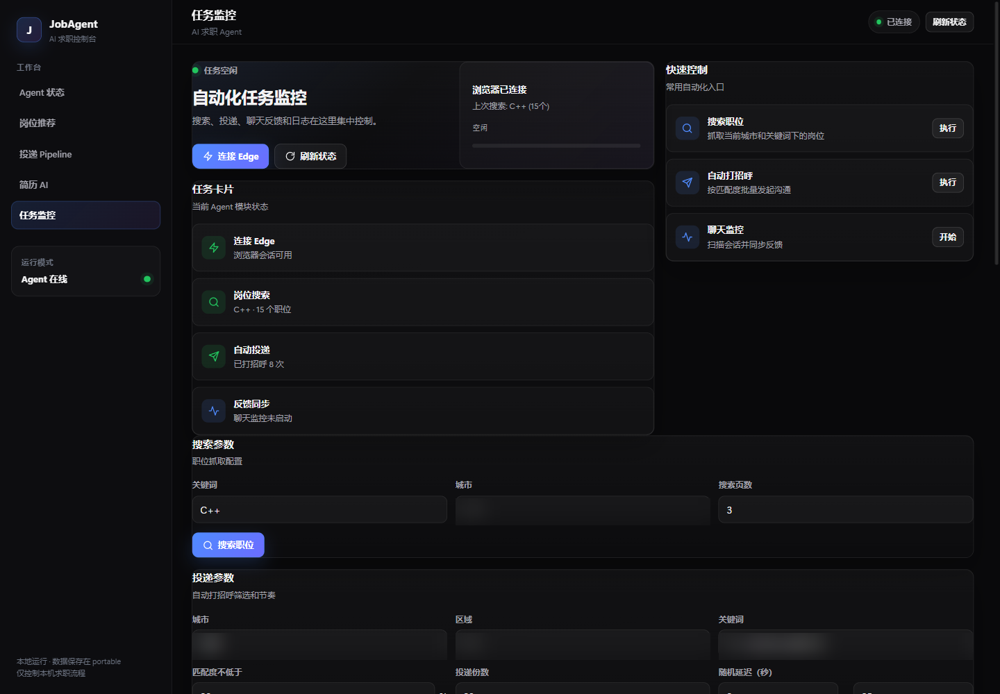

# 求职助手

本地运行的自动求职代理。当前默认平台是 BOSS 直聘，负责职位抓取、筛选、评分、简历匹配、投递和反馈统计。

## 功能

- 自动连接本机 Edge / Chrome / Chromium（CDP 9222），固定复用登录配置
- 按筛选条件搜索、抓取并解析平台职位
- 按技能、经验、学历计算岗位匹配度
- 自动生成 `AUTO_APPLY / REVIEW / IGNORE` 投递决策
- 自动选择并关联简历，历史投递记录自动补挂简历
- 批量投递打招呼，单职位手动沟通
- 自动输入自定义打招呼语，并通过聊天状态变化复核发送结果
- 打招呼后自动生成并发送简历截图，规避 HR 未回复时不能发附件的限制
- 投递记录自动去重，同一职位只保留一条记录
- 投递前跳过已投递职位，已投递完自动实时搜索新职位
- 聊天会话监控，支持查看和发送消息
- BOSS 聊天反馈自动同步：扫描会话消息，把已回复、面试、Offer、不合适回写为投递漏斗状态
- Cookie 自动备份与恢复
- 看护进程在浏览器异常后自动重试拉起
- 单任务并发锁，重复投递会被拦截
- 重复启动 exe 会自动顶掉旧实例，不产生双看护进程
- 本地控制台和 BOSS 直聘页均只保留一个标签页，后台任务不反复抢焦点
- 投递失败时保留最后一个平台页面，不再关闭浏览器
- 反馈漏斗统计（待处理/已查看/已回复/面试/Offer）与策略建议
- 本地 Web 控制台，默认 http://localhost:3456，采用求职作战台仪表盘，支持投递状态轨道、移动端和键盘焦点
- 结构化简历编辑，支持维护工作/项目/教育经历，并导出 PDF/Word

## 平台抽象

平台相关逻辑集中在 `src/platforms/`：

- `src/platforms/index.js`：平台注册表和默认平台
- `src/platforms/boss.js`：BOSS 直聘适配器

默认平台通过环境变量控制：

```bash
JOB_PLATFORM=boss
```

新平台只需要实现同一个 adapter 接口（页面定位、登录判断、Cookie 备份、抓取器、投递机器人），然后在 `src/platforms/index.js` 注册。切换平台时修改 `JOB_PLATFORM` 或 `DEFAULT_PLATFORM` 一行即可。

## 跨平台

- Windows：支持 Edge、Chrome、Chromium，桌面 exe 使用 Node SEA 打包
- macOS / Linux：直接用 Node 运行，自动发现 Chrome / Chromium / Edge
- 可用 `BROWSER_PATH` 显式指定浏览器可执行文件
- 浏览器发现、进程清理、端口检查、打开 URL 均按平台实现，不再依赖 PowerShell 作为唯一路径

## 技术栈

- Node.js 18+（ESM）
- puppeteer-core（CDP 控制浏览器）
- tesseract.js（图片 OCR）
- SQLite（`node:sqlite`）
- 原生 http 服务 + 单页 Web UI
- Node SEA 单文件 exe 打包（Windows）

## 环境要求

- Windows 11 / macOS / Linux
- Microsoft Edge、Google Chrome 或 Chromium
- Node.js 18+
- 无需 GPU

## 启动

安装依赖：

```bash
npm install
```

开发模式运行：

```bash
npm start
```

浏览器打开 http://localhost:3456

Windows 也可以使用 `launcher.ps1` 或桌面 exe。首次使用在自动打开的页面扫码登录，Cookie 会自动备份。

## 操作台



## 操作步骤

### 1. 启动求职助手

双击桌面 `求职助手.exe`，或使用 `launcher.ps1` 启动。启动后会自动连接本机浏览器，并打开本地控制台。

控制台地址：

```text
http://127.0.0.1:3456
```

首次使用如果浏览器没有登录 BOSS 直聘，会自动打开扫码页。登录成功后 Cookie 会备份到 `portable/data/boss-cookies.json`。

### 2. 连接浏览器

进入“任务监控”页面，点击“连接 Edge”或“刷新状态”。状态变为“浏览器已连接”后，才能执行搜索和投递。

### 3. 搜索职位

在“搜索参数”中填写：

- 关键词：例如 `C++`
- 城市：例如 `台州`
- 搜索页数：建议 `3`

点击“搜索职位”，完成后会显示抓取到的职位数量，并写入本地数据库。

### 4. 自动打招呼并投递简历

在“投递参数”中设置：

- 城市、区域、关键词
- 最低匹配度
- 投递份数
- 随机延迟范围
- 打招呼语

保持以下选项开启：

- 跳过已投递职位
- 打招呼后发送简历截图

点击“开始投递”。任务会自动打开职位、发送打招呼，并在 BOSS 未回复时直接发送简历截图。

### 5. 聊天监控与反馈同步

在“聊天与反馈”中设置轮询间隔，可按需开启：

- 自动回复未读新消息
- HR 回复后自动发送简历截图

点击“开始监控”后，系统会持续扫描 BOSS 会话；也可以点击“同步反馈”手动把回复、面试、Offer 等状态写回投递记录。

### 6. 查看投递结果

进入“投递 Pipeline”查看待处理、已查看、已回复、面试、Offer 等状态；底部“Agent 日志”可查看最近 30 条任务日志。

## 数据位置

- 运行数据：`portable/`
- 登录配置：`.edge-profile/`，备用 `.edge-profile-2/`
- 用户档案：`portable/data/profile.json`
- Cookie 备份：`portable/data/boss-cookies.json`
- 聊天记录：`portable/data/chat.json`
- 简历编辑存档：`portable/resumes/resume-editor.json`
- 本地数据库：`portable/data/job-agent.db`，旧临时库首次启动会自动迁移

## 打包为 Windows exe

以后改完源码，统一执行一条命令即可完整重打：

```powershell
npm run build:exe
```

脚本会自动完成：图标生成、esbuild 打包（`sea-entry.cjs` / `sea-server.cjs` / `sea-worker.cjs`）、SEA blob 生成、Node SEA 注入、GUI 子系统修复并断言、图标与版本信息写入，最后自动复制到**当前用户**桌面（不写死本机路径）。产物位于：

- `dist\求职助手.exe`
- `%USERPROFILE%\Desktop\求职助手.exe`（脚本自动复制到当前用户桌面）

构建输入（必须齐全）：

| 输入 | 说明 |
|---|---|
| `node.exe` | SEA 基础可执行文件，构建脚本会自动检测；也可用 `-NodeExe` 指定 |
| `node_modules/` | esbuild / postject / rcedit / tesseract.js 等打包依赖，`npm install` 安装 |
| `tessdata/*.gz` | OCR 语言模型（`chi_sim` / `eng`），随 exe 嵌入 |
| `.env` | 环境变量配置，**会嵌入 exe 内** |

`dist/sea-worker.cjs`（tesseract worker 打包产物）不在上表内：它由构建脚本自动生成，无需手工准备。

> ⚠️ `.env` 会随构建嵌入 exe：请勿把 exe 外传给他人；修改 `.env` 后必须重新执行 `npm run build:exe` 才会生效。

打包依赖在首次安装时已包含：

```powershell
npm install
```

macOS / Linux 当前使用 Node 直接运行，暂不生成单文件安装包。

## 目录结构

```text
src/
  platforms/       平台适配层
  scrapers/        平台抓取器
  browser/         浏览器连接与 CDP 管理
  db/              数据访问层
  routes.mjs       HTTP API
  scoring.js       评分与决策
  chatApply.js     投递机器人
web/index.html     本地控制台
packaging/         SEA 打包与启动器
```

## API

- `GET /api/resume/editor`：读取结构化简历编辑内容
- `POST /api/resume/editor`：保存结构化简历编辑内容
- `GET /api/resume/export?format=pdf|docx`：导出 PDF 或 Word
- `POST /api/boss/sync-feedback`：扫描 BOSS 聊天会话，按 HR 最后消息更新投递状态。

## Git

- 远端：https://github.com/zly251/codex
- 项目分支：`autonomous-job-agent`（远端 `main` 已被其他工作区占用，不覆盖）
- 仓库内不写本机盘符和用户绝对路径；需要本机路径时使用环境变量、相对路径或 `-NodeExe` 等参数

```powershell
git status
git add .
git commit -m "说明"
git push origin HEAD:autonomous-job-agent
```

提交前检查 `git status`，只提交应用源码、配置和文档，不提交诊断脚本、临时文件、日志、模型和 API Key。如果本机仓库元数据和工作区分离，按当前机器实际位置临时指定 `--git-dir` 和 `--work-tree`，不要把路径写进仓库。

## License

MIT License，见 [LICENSE](LICENSE)。
