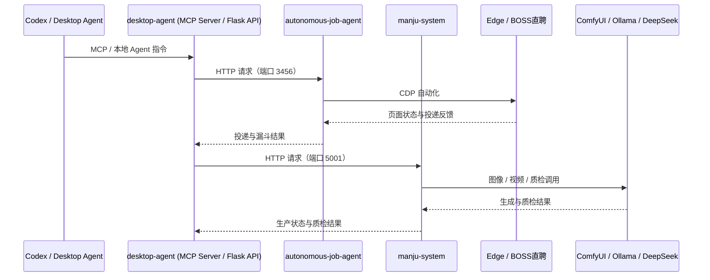

# Architecture

## Workspace

- 单仓库多项目，`apps/<应用>` 为可执行应用边界
- `packages/` 放置共享公共库
- 根目录只放工程规范和文档
- 外部项目用 git 子模块
- Python 应用由 uv workspace 统一管理

## 调用关系

当前实现中，`desktop-agent` 的 Flask API 提供 `/api/run`、`/api/stream/<task_id>` 等入口，`autonomous-job-agent` 与 `manju-system` 分别通过本地端口独立提供服务；上图为仓库内目标集成边界。

## 项目

### autonomous-job-agent

- Node.js + ESM
- puppeteer-core 控制 Edge
- server.mjs + src/routes.mjs 提供本地 Web UI
- src/scrapers 抓取 BOSS 直聘
- src/scoring.js 岗位匹配评分
- SQLite 本地存储

### desktop-agent

- Python + DeepSeek API
- 搜索、TTS、视频生成、Douyin 上传
- tkinter desktop_app.py + webui.py

### manju-system

- Python 内容生产管线
- ComfyUI 图像生成
- DeepSeek 内容脚本
- Ollama 视觉质检

### ai-agent-skills

- Markdown 学习与项目记录
- 位于 docs/skills/ai-agent-skills
